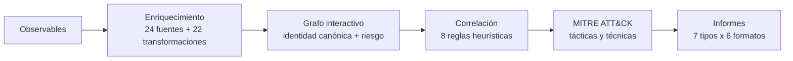

<div align="center">


# Estoa

**Inteligencia de amenazas local-first para escritorio.**

Convierte observables en un grafo interactivo, enriquécelos con fuentes abiertas
y comerciales, correlaciona hallazgos, mapea la actividad a MITRE ATT&CK y exporta
informes. Todo se queda en tu equipo.

<a href="https://github.com/mikear/estoa/releases/latest"></a>
<a href="docs/README.md"></a>

<br>

[](https://github.com/mikear/estoa/releases/latest)
[](https://github.com/mikear/estoa/releases/latest)
[](https://github.com/mikear/estoa/actions/workflows/build.yml)
[](https://github.com/mikear/estoa/releases/latest)
[](LICENSE)
[](#datos-y-privacidad)

<a href="docs/capturas/01-workspace-grafo.png" title="Abrir la captura completa"></a>

**Windows** · **Linux** · **macOS** · **~28 MB** · **Sin Java** · **MIT**

[Descarga](#descarga) · [Capturas](#capturas) · [Cómo funciona](#cómo-funciona) · [Documentación](docs/README.md) · [English](README.md)

</div>

---

## Índice

- [Descarga](#descarga)
- [Por qué Estoa](#por-qué-estoa)
- [Cómo funciona](#cómo-funciona)
- [Capacidades](#capacidades)
- [Capturas](#capturas)
- [Arranque rápido](#arranque-rápido)
- [Datos y privacidad](#datos-y-privacidad)
- [Compilar desde código](#compilar-desde-código)
- [Avisos de actualización](#avisos-de-actualización)
- [Hoja de ruta](#hoja-de-ruta)
- [Documentación](#documentación)
- [Contribuir](#contribuir)
- [Seguridad](#seguridad)
- [Reconocimientos](#reconocimientos)
- [Licencia](#licencia)

## Descarga

**No hace falta instalar Java.** Los instaladores y las versiones portables incluyen su propio runtime.

| Plataforma | Instalador | Portable |
|---|---|---|
| Windows x64 | [Estoa-windows-x64.exe](https://github.com/mikear/estoa/releases/latest/download/Estoa-windows-x64.exe) | [ZIP](https://github.com/mikear/estoa/releases/latest/download/Estoa-windows-x64-portable.zip) |
| Linux x64 | [estoa-linux-x64.deb](https://github.com/mikear/estoa/releases/latest/download/estoa-linux-x64.deb) | [tar.gz](https://github.com/mikear/estoa/releases/latest/download/estoa-linux-x64-portable.tar.gz) |
| macOS Intel | [Estoa-macos-x64.dmg](https://github.com/mikear/estoa/releases/latest/download/Estoa-macos-x64.dmg) | [ZIP](https://github.com/mikear/estoa/releases/latest/download/Estoa-macos-x64-portable.zip) |

[Checksums SHA256](https://github.com/mikear/estoa/releases/latest/download/SHA256SUMS.txt) · [Todas las releases](https://github.com/mikear/estoa/releases)

- **Windows 10/11 x64.** El instalador es por usuario y no requiere permisos de administrador.
- **Linux x64 con GTK3.** Instala con `sudo apt install ./estoa-linux-x64.deb` o extrae el archivo portable.
- **macOS 12+ en Intel.** Apple Silicon funciona mediante Rosetta; está previsto un build ARM64 nativo.
- Los instaladores v1 no están firmados, así que Windows SmartScreen o macOS Gatekeeper pueden pedir confirmación. Las versiones portables evitan el instalador, pero pueden mostrar el mismo aviso del sistema.

## Por qué Estoa

- **Local-first:** los casos y las claves API permanecen en tu equipo. H2 es la base de datos por defecto; PostgreSQL es opcional.
- **Nativo de grafos:** 28 tipos de entidad, identidad canónica, detección de comunidades, foco de vecindad y ocho disposiciones.
- **Triaje explicable:** riesgo 0-100 basado en CVSS, EPSS, KEV, VirusTotal, familia de malware, corroboración multifuente, conectividad y tipo de entidad.
- **Contexto accionable:** ocho reglas de correlación, mapeo ATT&CK, matriz de adyacencia y siete tipos de informe en seis formatos.
- **Extensible:** 24 conectores, 22 transformaciones tipo Maltego y SPI de complementos con `ServiceLoader`.
- **Sin lock-in:** JDBC puro sobre H2 o PostgreSQL, casos exportables y una base MIT que puedes auditar y reconstruir.

**De un vistazo:** 28 tipos de entidad · 24 conectores · 22 transformaciones · 8 disposiciones · 8 reglas de correlación · 7 informes × 6 formatos.

## Cómo funciona



1. **Añade observables** como dominios, IPs, hashes, certificados, CVEs o actores.
2. **Enriquece** con conectores abiertos y comerciales, o ejecuta pivotes tipo Maltego.
3. **Explora** el grafo canónico, agrupa entidades, enfoca vecindades y filtra por riesgo o TLP.
4. **Correlaciona** hallazgos en hipótesis con acciones sugeridas.
5. **Mapea** la actividad observada a ATT&CK y exporta un informe del caso.

## Capacidades

| Área | Qué incluye |
|---|---|
| Modelo de entidades | 28 tipos (dominio, IPv4/IPv6, ASN, netblock, hash, certificado, malware, APT, campaña, CVE, técnica/táctica ATT&CK, organización...) con atributos, TLP y riesgo |
| Grafo | Canvas JavaFX interactivo, zoom al cursor, paneo, arrastre con vecinos N1, selección múltiple con `Shift` + clic o rectángulo, anti-solapamiento, ocho disposiciones, agrupación por tipo/riesgo/TLP/comunidad, filtros, búsqueda, historial de foco y pantalla completa |
| Vistas de datos | Tabla ordenable y árbol de entidades con filtros combinados, selección múltiple, acciones de fila y sincronización con el grafo |
| Fuentes | 20 conectores abiertos y 4 comerciales (VirusTotal, Shodan, urlscan.io, URLQuery) |
| Transformaciones | 22 pivotes tipo Maltego sobre dominios, IPs, hashes, CVEs y actores |
| Correlación | Ocho reglas heurísticas con hipótesis y acciones sugeridas |
| ATT&CK | Bundle offline curado (~90 técnicas, 14 tácticas); la UI avisa de que no es la matriz Enterprise completa |
| Informes | Siete tipos × seis formatos: PDF, HTML, CSV, JSON, PNG, SVG |
| Persistencia | H2 embebida por defecto; perfil PostgreSQL para despliegues multi-analista |
| Complementos | JARs externos en `~/.orion/plugins/` que registran conectores y transformaciones |

## Capturas

| Disposiciones del grafo | Vista agrupada |
|---|---|
|  |  |

| Vista de tabla | Matriz ATT&CK |
|---|---|
|  |  |

| Correlación | Generador de informes |
|---|---|
|  |  |

## Arranque rápido

1. Instala Estoa o extrae la versión portable.
2. Abre la aplicación normalmente o carga la demostración integrada:

```text
Estoa --demo
```

Opciones de línea de comandos:

```text
--demo                 Carga el caso de demostración
--screenshot DIR       Captura 30 pantallas de la UI y sale
--version              Muestra la versión y sale
--no-update-check      Omite la comprobación de actualizaciones al arrancar
--live ...             Ejecuta la prueba headless de fuentes reales
```

## Datos y privacidad

- Los casos se guardan en `~/.orion/orion.db` por defecto.
- Las claves API se cifran con AES-256-GCM en `~/.orion/keys.dat`; no hay claves precargadas.
- La aplicación no sube datos de casos. Los conectores consultan sus fuentes solo cuando ejecutas un enriquecimiento.
- La caché de actualizaciones es `~/.orion/update.properties` y solo contiene metadatos de versión.
- El bundle ATT&CK embebido es un subconjunto curado, no la matriz Enterprise completa.
- No hay telemetría ni sistema de cuentas.

## Compilar desde código

Requisitos: JDK 21+ y Maven.

```bash
cd src
mvn test
mvn clean package -DskipTests            # Linux
mvn clean package -DskipTests -Pwindows  # Windows
mvn clean package -DskipTests -Pmacos    # macOS Intel
```

Generar instaladores y versiones portables:

```powershell
powershell -File packaging/package.ps1
```

```bash
bash packaging/package.sh
```

El workflow de release compila en Windows, Linux y macOS Intel. El instalador de Windows requiere WiX 3; el paquete `.deb` de Linux requiere `fakeroot`.

## Avisos de actualización

Estoa consulta la última release pública de GitHub como máximo una vez cada 24 horas. Si hay una versión nueva, muestra el número y un botón que abre la página de la release. **Más tarde** pospone el aviso de esa versión durante 7 días. Nunca descarga ni instala una actualización automáticamente.

- Comprobación manual: **Ayuda → Buscar actualizaciones...**
- La única petición de red al arrancar es la API de releases de GitHub.
- No se envía telemetría, cuenta ni clave API con la comprobación.
- Se puede desactivar con `--no-update-check`.

## Hoja de ruta

- [ ] Firma de código en Windows y notarización en macOS.
- [ ] Build nativo para Apple Silicon.
- [ ] Importación completa de MITRE ATT&CK Enterprise (el bundle actual es curado).
- [ ] Más conectores y transformaciones abiertas.
- [ ] Notas de release y changelog generados automáticamente.

¿Falta un caso de uso? Abre una [discusión](https://github.com/mikear/estoa/discussions) o un [issue](https://github.com/mikear/estoa/issues).

## Documentación

- [docs/README.md](docs/README.md) — capacidades y avisos legales
- [docs/INSTALACION.md](docs/INSTALACION.md) — instalación, base de datos, claves API y resolución de problemas
- [docs/ARQUITECTURA.md](docs/ARQUITECTURA.md) — módulos y decisiones de diseño
- [docs/MANUAL-USUARIO.md](docs/MANUAL-USUARIO.md) — flujos de investigación
- [LEEME.txt](LEEME.txt) — resumen de arranque
- [RELEASE_NOTES.md](RELEASE_NOTES.md) — notas de la versión
- [DISCLAIMER.md](DISCLAIMER.md) — uso autorizado y avisos de fuentes

## Contribuir

Todo aporte es bienvenido: reportes de error, ideas de conectores, mejoras de la UI, traducciones y correcciones de documentación.

- Lee [CONTRIBUTING.md](CONTRIBUTING.md) y el [código de conducta](CODE_OF_CONDUCT.md).
- Usa las plantillas de [bug](https://github.com/mikear/estoa/issues/new?template=bug_report.yml) o [nueva función](https://github.com/mikear/estoa/issues/new?template=feature_request.yml).
- Para preguntas o ideas, usá [Discussions](https://github.com/mikear/estoa/discussions).
- Si encontrás una vulnerabilidad, no abras un issue público: ver [SECURITY.md](SECURITY.md).

## Seguridad

Estoa es una herramienta defensiva para trabajo de seguridad autorizado. Reporta vulnerabilidades de forma privada mediante [GitHub Security Advisories](https://github.com/mikear/estoa/security/advisories/new) y leé [SECURITY.md](SECURITY.md) para el alcance y los plazos de respuesta.

## Reconocimientos

- MITRE ATT&CK® — el bundle embebido es un subconjunto curado, © The MITRE Corporation, CC BY 4.0.
- [Tabler Icons](https://tabler.io/icons) (MIT) para el set de iconos.
- OpenJFX, Spring Boot, H2 y PostgreSQL.

Los avisos de terceros están en [NOTICE](NOTICE).

## Licencia

MIT — ver [LICENSE](LICENSE). Estoa está pensada para profesionales de seguridad autorizados.

<div align="center">

Si te sirvió, deja una estrella

[](https://github.com/mikear/estoa)

</div>
