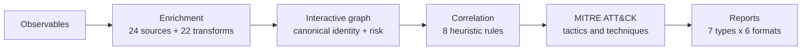
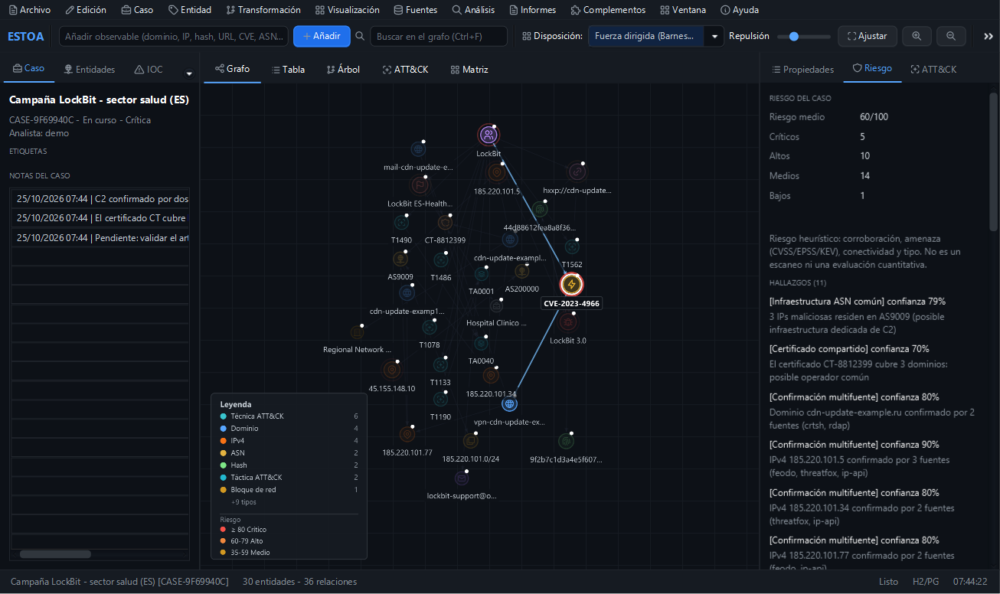
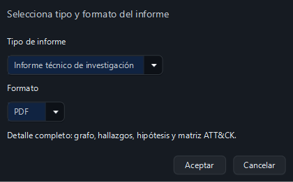

<div align="center">


# Estoa

**Local-first threat intelligence for the desktop.**

Turn observables into an interactive graph, enrich them with open and commercial
sources, correlate findings, map activity to MITRE ATT&CK, and export reports.
Everything stays on your machine.

<a href="https://github.com/mikear/estoa/releases/latest"></a>
<a href="docs/README.md"></a>

<br>

[](https://github.com/mikear/estoa/releases/latest)
[](https://github.com/mikear/estoa/releases/latest)
[](https://github.com/mikear/estoa/actions/workflows/build.yml)
[](https://github.com/mikear/estoa/releases/latest)
[](LICENSE)
[](#data-and-privacy)

<a href="docs/capturas/01-workspace-grafo.png" title="Open the full screenshot"></a>

**Windows** · **Linux** · **macOS** · **~28 MB** · **No Java required** · **MIT**

[Download](#download) · [Screenshots](#screenshots) · [How it works](#how-it-works) · [Documentation](docs/README.md) · [Español](README.es.md)

</div>

---

## Contents

- [Download](#download)
- [Why Estoa](#why-estoa)
- [How it works](#how-it-works)
- [Features](#features)
- [Screenshots](#screenshots)
- [Quick start](#quick-start)
- [Data and privacy](#data-and-privacy)
- [Build from source](#build-from-source)
- [Update notifications](#update-notifications)
- [Roadmap](#roadmap)
- [Documentation](#documentation)
- [Contributing](#contributing)
- [Security](#security)
- [Acknowledgements](#acknowledgements)
- [License](#license)

## Download

**No Java installation required.** The installers and portable builds include their own runtime.

| Platform | Installer | Portable |
|---|---|---|
| Windows x64 | [Estoa-windows-x64.exe](https://github.com/mikear/estoa/releases/latest/download/Estoa-windows-x64.exe) | [ZIP](https://github.com/mikear/estoa/releases/latest/download/Estoa-windows-x64-portable.zip) |
| Linux x64 | [estoa-linux-x64.deb](https://github.com/mikear/estoa/releases/latest/download/estoa-linux-x64.deb) | [tar.gz](https://github.com/mikear/estoa/releases/latest/download/estoa-linux-x64-portable.tar.gz) |
| macOS Intel | [Estoa-macos-x64.dmg](https://github.com/mikear/estoa/releases/latest/download/Estoa-macos-x64.dmg) | [ZIP](https://github.com/mikear/estoa/releases/latest/download/Estoa-macos-x64-portable.zip) |

[SHA256 checksums](https://github.com/mikear/estoa/releases/latest/download/SHA256SUMS.txt) · [All releases](https://github.com/mikear/estoa/releases)

- **Windows 10/11 x64.** The installer is per-user and does not require administrator rights.
- **Linux x64 with GTK3.** Install with `sudo apt install ./estoa-linux-x64.deb`, or extract the portable archive.
- **macOS 12+ on Intel.** Apple Silicon works through Rosetta; a native ARM64 build is planned.
- The v1 installers are not code-signed, so Windows SmartScreen or macOS Gatekeeper may ask for confirmation. The portable builds avoid the installer but may show the same OS warning.

## Why Estoa

- **Local-first:** cases and API keys stay on your machine. H2 is the default database; PostgreSQL is optional.
- **Graph-native:** 28 entity types, canonical identities, community detection, neighborhood focus, and eight layouts.
- **Explainable triage:** a 0-100 risk score driven by CVSS, EPSS, KEV, VirusTotal, malware family, multi-source corroboration, connectivity, and entity type.
- **Actionable context:** eight correlation rules, ATT&CK mapping, an adjacency matrix, and seven report types in six formats.
- **Extensible:** 24 data connectors, 22 Maltego-style transforms, and a `ServiceLoader` plugin SPI.
- **No lock-in:** plain JDBC over H2 or PostgreSQL, exportable cases, and an MIT-licensed codebase you can audit and rebuild.

**At a glance:** 28 entity types · 24 connectors · 22 transforms · 8 layouts · 8 correlation rules · 7 report types × 6 formats.

## How it works



1. **Add observables** such as domains, IPs, hashes, certificates, CVEs, or actors.
2. **Enrich** them with open and commercial connectors, or run Maltego-style pivots.
3. **Explore** the canonical graph, group entities, focus on neighborhoods, and filter by risk or TLP.
4. **Correlate** findings into hypotheses with suggested next actions.
5. **Map** observed activity to ATT&CK and export a report for the case.

## Features

| Area | What you get |
|---|---|
| Entity model | 28 types (domain, IPv4/IPv6, ASN, netblock, hash, certificate, malware, APT, campaign, CVE, ATT&CK technique/tactic, organization...) with attributes, TLP, and risk |
| Graph | Interactive JavaFX canvas, zoom to cursor, pan, N1 neighbor dragging, multi-select with `Shift` + click or rubber band, anti-overlap, eight layouts, grouping by type/risk/TLP/community, filters, search, focus history, fullscreen |
| Data views | Sortable table and entity tree with combined filters, multi-select, row actions, and graph synchronization |
| Sources | 20 open connectors and 4 commercial connectors (VirusTotal, Shodan, urlscan.io, URLQuery) |
| Transforms | 22 Maltego-style pivots across domains, IPs, hashes, CVEs, and actors |
| Correlation | Eight heuristic rules with hypotheses and suggested next actions |
| ATT&CK | Offline curated bundle (~90 techniques, 14 tactics); the UI states that it is not the full Enterprise matrix |
| Reports | Seven report types × six formats: PDF, HTML, CSV, JSON, PNG, SVG |
| Storage | Embedded H2 by default; PostgreSQL profile for multi-analyst deployments |
| Plugins | External JARs in `~/.orion/plugins/` can register connectors and transforms |

## Screenshots

| Graph layouts | Grouped view |
|---|---|
|  |  |

| Data table | ATT&CK matrix |
|---|---|
|  |  |

| Correlation | Report generator |
|---|---|
|  |  |

## Quick start

1. Install Estoa or extract the portable build.
2. Launch it normally, or open the built-in demo:

```text
Estoa --demo
```

CLI options:

```text
--demo                 Load the demo investigation
--screenshot DIR       Capture 30 UI screenshots and exit
--version              Print the version and exit
--no-update-check      Skip the startup update check
--live ...             Run the headless live-source probe
```

## Data and privacy

- Cases are stored in `~/.orion/orion.db` by default.
- API keys are encrypted with AES-256-GCM in `~/.orion/keys.dat`; no keys are preloaded.
- The application does not upload case data. Connectors contact their sources only when you run an enrichment.
- The update cache is `~/.orion/update.properties` and contains only version metadata.
- The embedded ATT&CK bundle is a curated subset, not the full Enterprise matrix.
- There is no telemetry and no account system.

## Build from source

Requirements: JDK 21+ and Maven.

```bash
cd src
mvn test
mvn clean package -DskipTests            # Linux
mvn clean package -DskipTests -Pwindows  # Windows
mvn clean package -DskipTests -Pmacos    # macOS Intel
```

Build installers and portable bundles:

```powershell
powershell -File packaging/package.ps1
```

```bash
bash packaging/package.sh
```

The release workflow builds on Windows, Linux, and macOS Intel. Windows installers require WiX 3; Linux `.deb` packaging requires `fakeroot`.

## Update notifications

Estoa checks the latest public GitHub release at most once every 24 hours. When a newer version exists, it shows the version and a button that opens the release page. It never downloads or installs an update automatically.

- Manual check: **Ayuda → Buscar actualizaciones...**
- The only startup network request is the GitHub Releases API.
- No telemetry, account, or API key is sent with the check.
- Disable it with `--no-update-check`.

## Roadmap

- [ ] Code signing on Windows and notarization on macOS.
- [ ] Native Apple Silicon build.
- [ ] Full MITRE ATT&CK Enterprise import (the current bundle is curated).
- [ ] More open connectors and transforms.
- [ ] Automated release notes and changelog generation.

Have a use case that is missing? Open a [discussion](https://github.com/mikear/estoa/discussions) or an [issue](https://github.com/mikear/estoa/issues).

## Documentation

The detailed guides under `docs/` are currently in Spanish.

- [docs/README.md](docs/README.md) — capabilities and legal notes
- [docs/INSTALACION.md](docs/INSTALACION.md) — install, database, API keys, troubleshooting
- [docs/ARQUITECTURA.md](docs/ARQUITECTURA.md) — modules and design decisions
- [docs/MANUAL-USUARIO.md](docs/MANUAL-USUARIO.md) — investigation workflows
- [LEEME.txt](LEEME.txt) — Spanish quick-start summary
- [RELEASE_NOTES.md](RELEASE_NOTES.md) — release notes
- [DISCLAIMER.md](DISCLAIMER.md) — authorized use and data source notices

## Contributing

Contributions are welcome: bug reports, connector ideas, UI improvements, translations, and documentation fixes.

- Read [CONTRIBUTING.md](CONTRIBUTING.md) and the [Code of Conduct](CODE_OF_CONDUCT.md).
- Use the [bug report](https://github.com/mikear/estoa/issues/new?template=bug_report.yml) or [feature request](https://github.com/mikear/estoa/issues/new?template=feature_request.yml) templates.
- Ask questions and share workflows in [Discussions](https://github.com/mikear/estoa/discussions).
- Never open a public issue for a vulnerability; see [SECURITY.md](SECURITY.md).

## Security

Estoa is a defensive tool for authorized security work. Report vulnerabilities privately through [GitHub Security Advisories](https://github.com/mikear/estoa/security/advisories/new) and read [SECURITY.md](SECURITY.md) for scope and response times.

## Acknowledgements

- MITRE ATT&CK® — the embedded bundle is a curated subset, © The MITRE Corporation, CC BY 4.0.
- [Tabler Icons](https://tabler.io/icons) (MIT) for the icon set.
- OpenJFX, Spring Boot, H2, and PostgreSQL.

Third-party notices are listed in [NOTICE](NOTICE).

## License

MIT — see [LICENSE](LICENSE). Estoa is intended for authorized security professionals.

<div align="center">

If Estoa is useful, a star helps others find it.

[](https://github.com/mikear/estoa)

</div>
