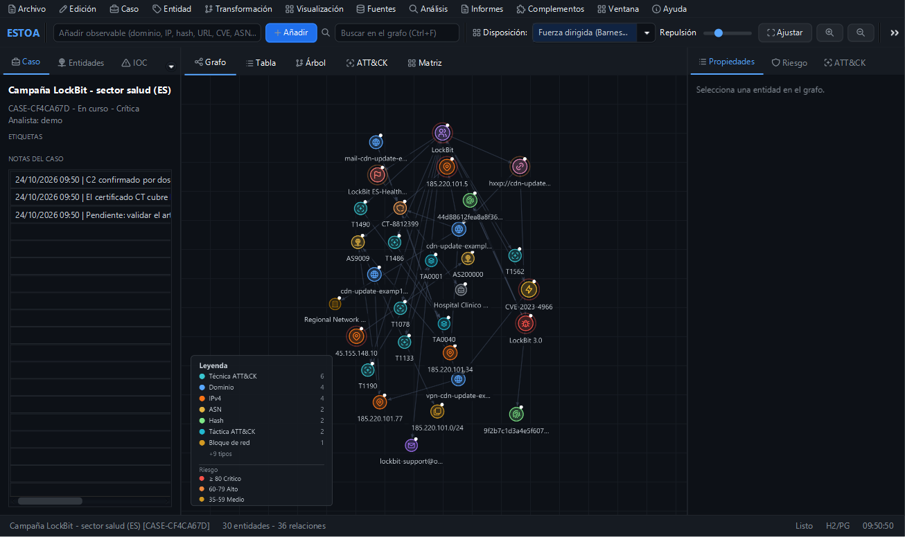
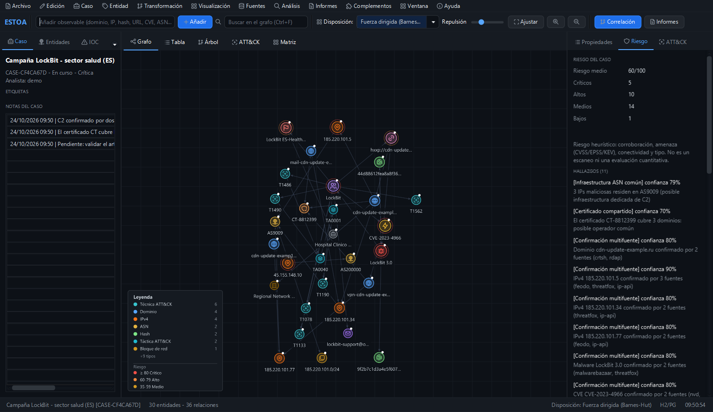
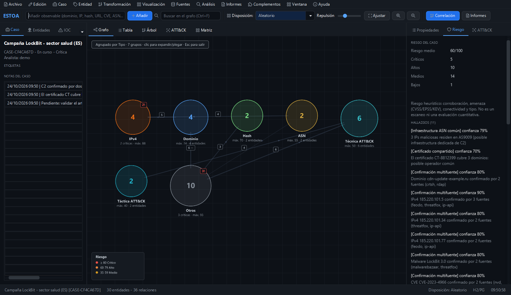
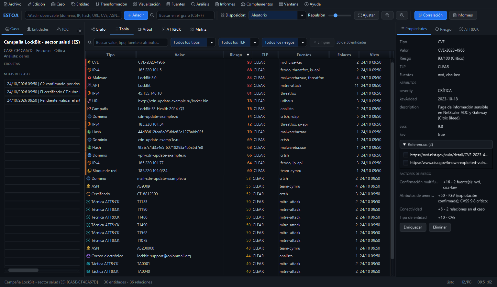
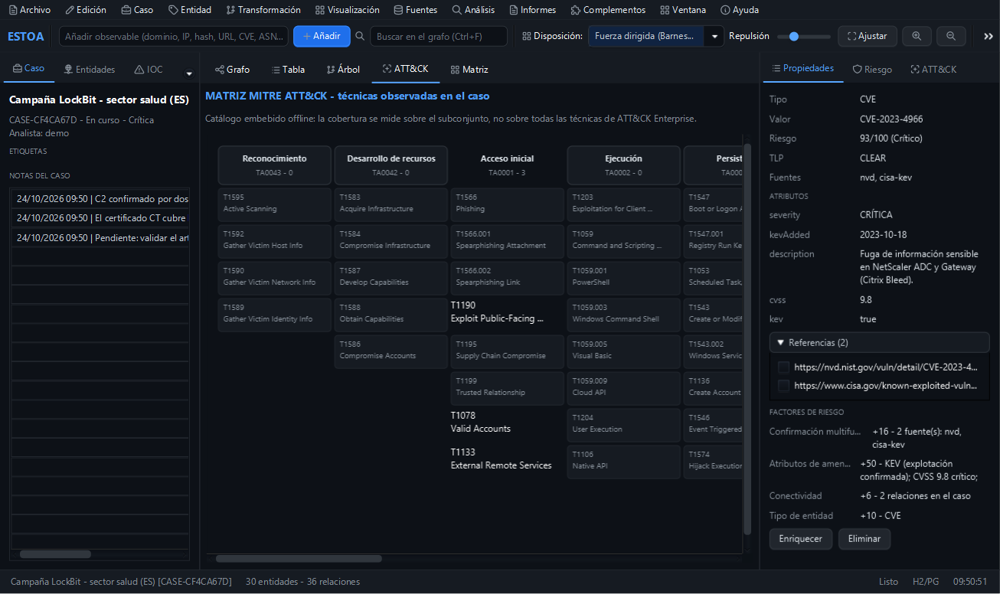

# Estoa

**Local-first threat intelligence for the desktop.** Turn observables into an interactive graph, enrich them with open and commercial sources, correlate findings, map activity to MITRE ATT&CK, and export reports. Built with Java 21, JavaFX, and Spring Boot.

[Español](README.es.md) · [Documentation](docs/README.md) · [Latest release](https://github.com/mikear/estoa/releases/latest)



## Download

**No Java installation required.** The installers and portable builds include their own runtime.

| Platform | Installer | Portable |
|---|---|---|
| Windows x64 | [Estoa-windows-x64.exe](https://github.com/mikear/estoa/releases/latest/download/Estoa-windows-x64.exe) | [ZIP](https://github.com/mikear/estoa/releases/latest/download/Estoa-windows-x64-portable.zip) |
| Linux x64 | [estoa-linux-x64.deb](https://github.com/mikear/estoa/releases/latest/download/estoa-linux-x64.deb) | [tar.gz](https://github.com/mikear/estoa/releases/latest/download/estoa-linux-x64-portable.tar.gz) |
| macOS Intel | [Estoa-macos-x64.dmg](https://github.com/mikear/estoa/releases/latest/download/Estoa-macos-x64.dmg) | [ZIP](https://github.com/mikear/estoa/releases/latest/download/Estoa-macos-x64-portable.zip) |

[SHA256 checksums](https://github.com/mikear/estoa/releases/latest/download/SHA256SUMS.txt)

- Windows 10/11 x64. The installer is per-user and does not require administrator rights.
- Linux x64 with GTK3. Install with `sudo apt install ./estoa-linux-x64.deb`, or extract the portable archive.
- macOS 12+ on Intel. Apple Silicon works through Rosetta; a native ARM64 build is planned.
- The v1 installers are not code-signed, so Windows SmartScreen or macOS Gatekeeper may ask for confirmation. The portable builds avoid the installer but may show the same OS warning.

## Why Estoa

- **Local-first:** cases and API keys stay on your machine. H2 is the default database; PostgreSQL is optional.
- **Graph-native:** 28 entity types, canonical identities, community detection, neighborhood focus, and eight layouts.
- **Explainable triage:** a 0-100 risk score driven by CVSS, EPSS, KEV, VirusTotal, malware family, multi-source corroboration, connectivity, and entity type.
- **Actionable context:** eight correlation rules, ATT&CK mapping, an adjacency matrix, and seven report types in six formats.
- **Extensible:** 24 data connectors, 22 Maltego-style transforms, and a `ServiceLoader` plugin SPI.

## Features

| Area | What you get |
|---|---|
| Entity model | 28 types (domain, IPv4/IPv6, ASN, netblock, hash, certificate, malware, APT, campaign, CVE, ATT&CK technique/tactic, organization...) with attributes, TLP, and risk |
| Graph | Interactive JavaFX canvas, zoom to cursor, pan, N1 neighbor dragging, anti-overlap, eight layouts, grouping by type/risk/TLP/community, filters, search, focus history, fullscreen |
| Data views | Sortable table and entity tree with combined filters, row actions, and graph synchronization |
| Sources | 20 open connectors and 4 commercial connectors (VirusTotal, Shodan, urlscan.io, URLQuery) |
| Transforms | 22 Maltego-style pivots across domains, IPs, hashes, CVEs, and actors |
| Correlation | Eight heuristic rules with hypotheses and suggested next actions |
| ATT&CK | Offline curated bundle (~90 techniques, 14 tactics); the UI states that it is not the full Enterprise matrix |
| Reports | Seven report types × six formats: PDF, HTML, CSV, JSON, PNG, SVG |
| Storage | Embedded H2 by default; PostgreSQL profile for multi-analyst deployments |
| Plugins | External JARs in `~/.orion/plugins/` can register connectors and transforms |

## Screenshots

| Graph layouts | Grouped view |
|---|---|
|  |  |

| Data table | ATT&CK matrix |
|---|---|
|  |  |

## Quick start

1. Install Estoa or extract the portable build.
2. Launch it normally, or open the built-in demo:

```text
Estoa --demo
```

CLI options:

```text
--demo                 Load the demo investigation
--screenshot DIR       Capture 30 UI screenshots and exit
--version              Print the version and exit
--no-update-check      Skip the startup update check
--live ...             Run the headless live-source probe
```

## Update notifications

Estoa checks the latest public GitHub release at most once every 24 hours. When a newer version exists, it shows the version and a button that opens the release page. It never downloads or installs an update automatically.

- Manual check: **Ayuda → Buscar actualizaciones...**
- The only startup network request is the GitHub Releases API.
- No telemetry, account, or API key is sent with the check.
- Disable it with `--no-update-check`.

## Build from source

Requirements: JDK 21+ and Maven.

```bash
cd src
mvn test
mvn clean package -DskipTests            # Linux
mvn clean package -DskipTests -Pwindows  # Windows
mvn clean package -DskipTests -Pmacos    # macOS Intel
```

Build installers and portable bundles:

```powershell
powershell -File packaging/package.ps1
```

```bash
bash packaging/package.sh
```

The release workflow builds on Windows, Linux, and macOS Intel. Windows installers require WiX 3; Linux `.deb` packaging requires `fakeroot`.

## Data and privacy

- Cases are stored in `~/.orion/orion.db` by default.
- API keys are encrypted with AES-256-GCM in `~/.orion/keys.dat`; no keys are preloaded.
- The application does not upload case data. Connectors contact their sources only when you run an enrichment.
- The update cache is `~/.orion/update.properties` and contains only version metadata.
- The embedded ATT&CK bundle is a curated subset, not the full Enterprise matrix.

## Documentation

- [docs/README.md](docs/README.md) — capabilities and legal notes
- [docs/INSTALACION.md](docs/INSTALACION.md) — install, database, API keys, troubleshooting
- [docs/ARQUITECTURA.md](docs/ARQUITECTURA.md) — modules and design decisions
- [docs/MANUAL-USUARIO.md](docs/MANUAL-USUARIO.md) — investigation workflows
- [LEEME.txt](LEEME.txt) — Spanish quick-start summary
- [RELEASE_NOTES.md](RELEASE_NOTES.md) — release notes

## License

MIT — see [LICENSE](LICENSE).

Estoa is intended for authorized security professionals. The embedded MITRE ATT&CK data is a subset of the MITRE ATT&CK project (Copyright The MITRE Corporation, CC BY 4.0).

Developed by **mikear** — [github.com/mikear](https://github.com/mikear).
